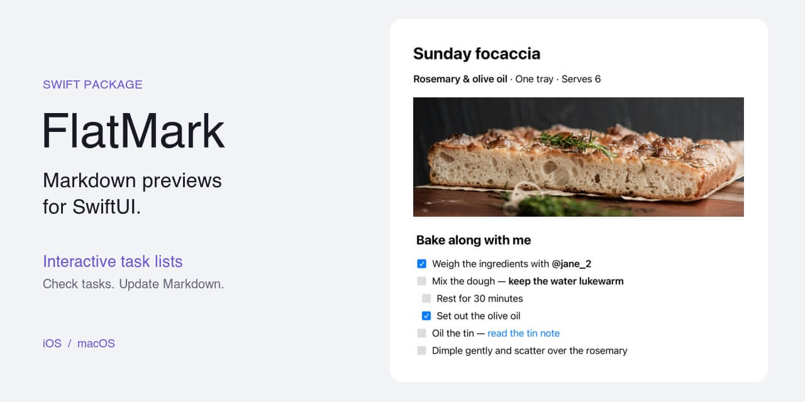

# FlatMark



[](https://swiftpackageindex.com/NoemiRozpara/FlatMark)
 
A native SwiftUI GitHub Flavored Markdown preview renderer for iOS 17+ and macOS 15+, with optional
interactive task lists. Parsing uses [swift-markdown](https://github.com/swiftlang/swift-markdown).

[Documentation](Documentation/README.md) · [Usage guide](Documentation/Usage.md) · [Markdown support](Documentation/MarkdownSupport.md) · [Demo](Demo/README.md) · [Testing](Tests/README.md) · [Benchmarks](Benchmarks/README.md) ·
[Contributing](CONTRIBUTING.md) · [Security](SECURITY.md) · [Changelog](CHANGELOG.md)

## What & Why _Flat_ Mark

FlatMark previews GitHub Flavored Markdown as native SwiftUI views. No WebView and no HTML pipeline sit
in your app; [swift-markdown](https://github.com/swiftlang/swift-markdown) does the parsing, and FlatMark
decides how the result reaches the screen.

Renderers that mirror the Markdown tree in nested views pay for depth itself. Each extra level adds
another container for SwiftUI to diff and lay out, so a deeply nested list can hold the main thread
inside a frame budget you do not own.

FlatMark flattens instead. A projection pass turns the tree into a shallow value-type render model, and
the view layer reads that model rather than the tree:

1. **Parse.** swift-markdown builds the CommonMark/GFM syntax tree from your source, giving a
   `Document` of `Markup` nodes.
2. **Project.** FlatMark walks that tree once, in document order. Nested list items become sibling rows
   carrying an `indentation` count, and inline spans become `AttributedString` runs. The result is a
   `FlatMarkRenderDocument` of plain `Sendable` value types.
3. **Render.** `FlatMarkView` lays out a flat array of blocks in a `LazyVStack`, keyed by an identity
   taken from each node's position in the tree. SwiftUI builds the native text, lists, quotes, tables,
   and code.

Flattening and lazy mounting reduce different kinds of rendering work:

- **List depth stops multiplying views.** A nested list contributes rows to its parent's array plus an
  `indentation` count. There are no recursive list views, so going deeper adds rows rather than adding
  view types and containers to lay out.
- **Deferred mounting.** This renderer gives a `LazyVStack` a shallow sequence of top-level blocks,
  letting SwiftUI defer offscreen blocks and reduce initial mounting work for long documents.
- **Stable identity.** The model uses value types and path-based identity, so blocks at unchanged tree
  positions keep their identity across updates. Retaining a [`FlatMarkDocument`](#reusing-a-document)
  skips parsing and projection too.

The [benchmarks](Benchmarks/README.md) measure construction and initial preview mounting.
Block quotes still nest as views, and quote, list, and table content mounts eagerly.

### What renders

GitHub Flavored Markdown, projected onto native views. The [support matrix](Documentation/MarkdownSupport.md) covers every
construct and its policy.

- **Text.** Paragraphs, ATX and Setext headings with semantic heading roles, emphasis, strong, nested
  emphasis, strikethrough, code spans, and bold `@username` mentions — all selectable native text in
  system semantic fonts, with no fixed point size.
- **Blocks.** Block quotes with a leading rule, thematic breaks, and fenced or indented code blocks.
- **Lists.** Bullet and ordered lists with authored start numbers, continuation blocks, and nested
  items. [Task lists](#interactive-tasks) can toggle their own source marker.
- **Tables.** GFM tables as a native grid that scrolls horizontally, with colspan honored and header
  cells marked for accessibility.
- **Links and images.** Inline, reference, and angle-bracket links; images load inline through your
  loader, or stay as network-free placeholders without one.

Left alone on purpose: GFM extended autolinks (`www.`, bare emails) stay plain text, parsed column
alignment does not change cell alignment, link and image titles are dropped, and raw HTML stays inert.

### Scope

FlatMark is a preview renderer, not a Markdown editor, general serializer, browser, HTML sanitizer, or
GitHub web clone. Its only source mutation is an interacted task marker. Repository-context links,
issue expansion, server-side transformations, and other GitHub-specific post-processing are out of scope.

## Demo

Open [Demo/FlatMarkDemo.xcodeproj](Demo/FlatMarkDemo.xcodeproj), select **FlatMarkDemo-iOS** or
**FlatMarkDemo-macOS**, and Run. See [demo setup](Demo/README.md) for signing and capture presets.

## Installation

In Xcode, choose **File → Add Package Dependencies**, enter
`https://github.com/NoemiRozpara/FlatMark.git`, select **Up to Next Minor Version** from **0.1.1**,
and add the **FlatMark** library product to your app target.

For a Swift package, add the dependency and product:

```swift
// Package dependencies:
.package(url: "https://github.com/NoemiRozpara/FlatMark.git", .upToNextMinor(from: "0.1.1"))

// Your target's dependencies:
.product(name: "FlatMark", package: "FlatMark")
```

Read the documentation at your dependency's tag. Before 1.0, breaking changes require a minor
release; the recommended range accepts patch releases only
([versioning policy](Documentation/Versioning.md#breaking-changes-before-100)). Released changes are listed in
[CHANGELOG.md](CHANGELOG.md).
The demo and shared fixtures are not built or embedded in the `FlatMark` package product.

## Usage

```swift
import FlatMark
import SwiftUI

struct MarkdownPreview: View {
    let markdown: String

    var body: some View {
        FlatMarkView(markdown: markdown)
    }
}
```

### What you own

FlatMark renders; your app decides what happens next. The full link, image, and HTML threat model is in
[SECURITY.md](SECURITY.md).

| Responsibility | Owner |
| --- | --- |
| Source text and persistence | You |
| Navigation decisions | You, through `linkActivationAction` or the inherited SwiftUI `openURL` action |
| Image fetching, decoding, authentication, caching | Your `FlatMarkImageLoader` |
| Accepting a task edit | You; FlatMark hands back updated source, you store it |

Two defaults to know before wiring anything up:

- Links have **no scheme allowlist or same-origin restriction**. Activation uses the inherited SwiftUI
  `openURL` action unless the host handles or rejects it. See
  [navigation policy](Documentation/Usage.md#links-and-document-bases).
- Without a loader, images are deterministic, network-free alt-text placeholders. See
  [image loading](Documentation/Usage.md#images). Allowing navigation does not authorize image fetching.

### Interactive tasks

`taskToggleAction` receives the complete updated source. The host owns persistence:

```swift
FlatMarkView(
    markdown: markdown,
    taskToggleAction: { markdown = $0 }
)
```

Only the tapped marker's state byte changes (`[ ]` ↔ `[x]`, lowercase `x`); every other byte,
including Unicode and line endings, is preserved. Updates derive from the rendered snapshot, not a
newer host string. Hosts that defer accepting a result must prevent stale results from overwriting
newer content. Without a callback, tasks remain static accessible content. Live VoiceOver and keyboard
behavior still need platform verification. See [task contracts and custom markers](Documentation/Usage.md#interactive-tasks).

### Reusing a document

Retain a snapshot to avoid repeated parsing and projection:

```swift
let document = FlatMarkDocument(
    markdown: markdown,
    baseURL: URL(string: "https://example.com/docs/")
)

FlatMarkView(document: document)
```

Rebuild when the source or `baseURL` changes. Construction is synchronous; retained reuse avoids
construction, not layout or rendering. See [document contracts](Documentation/Usage.md#reusing-a-document).

### Known limits

- Unsupported content is inert literal text by default, or can be omitted by parser node. FlatMark
  never executes HTML or fetches HTML resources. See [unsupported content](Documentation/Usage.md#unsupported-content).
- Native text is selectable, but selection may reset on updates and does not span blocks.
- Tables scroll horizontally, and their cells use a fixed width.
- Extreme nesting can stall preview mounting. A recorded 32-level quote/list stress fixture did not
  finish mounting on an iPhone XR within the capture driver's 180-second wait. This is an accepted
  0.1.0 limitation, not a safe input-depth threshold. Hosts must choose their own content/resource
  limits. See [benchmark limits](Benchmarks/README.md#known-performance-limits).
- Native typography, attachment behavior, and accessibility qualifications are in
  [layout and selection limits](Documentation/Usage.md#layout-and-selection-limits). Live VoiceOver and
  keyboard behavior still need platform verification.

## Requirements

- Xcode 26.0+ / Swift 6.2
- iOS 17+ / macOS 15+
- [swift-markdown](https://github.com/swiftlang/swift-markdown) 0.9.x

See [contributor guidance](Documentation/Contributing/BuildAndTest.md#toolchain) for platform-floor rationale and
verification boundaries.

## License

FlatMark's source code and documentation are available under the [MIT License](LICENSE).
The bundled fixture images have separate terms; see [asset notices](Support/FlatMarkFixtures/ASSETS.md)
for photo attribution and the attribution requirement on the Flaticon leaf icon.
